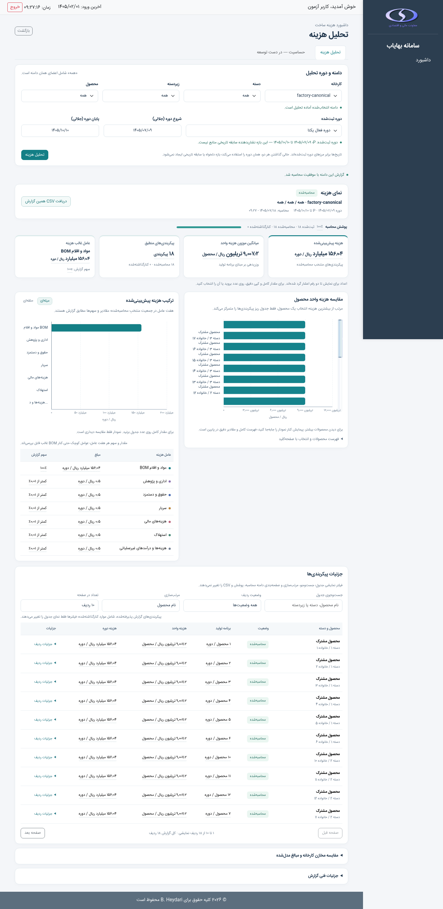
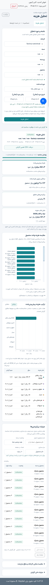
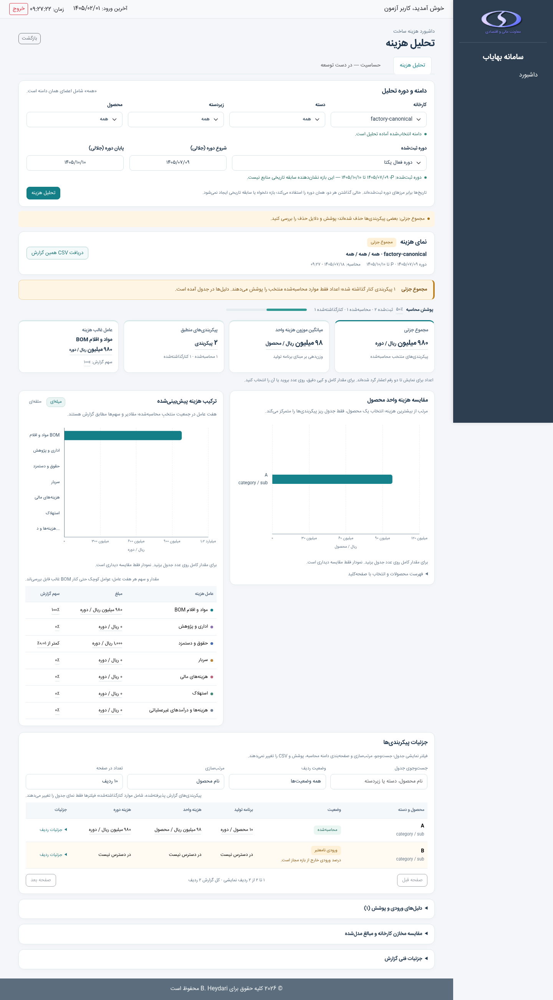
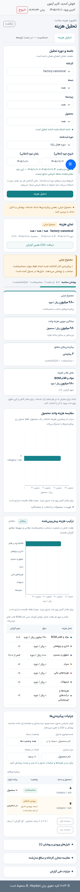

# PR-07 / DASH-4 — رابط تحلیل هزینه

صفحه `/dashboard` گزارش نسخه ۱ [PR-06](pr06-dashboard-cost-analysis-api.md)
را به فارسی و RTL ارائه می‌کند. پوسته مشترک، Bootstrap، IRANSansX، مجوز
`dashboard:READ` و فرمول و دروازه‌های G1–G4 حفظ می‌شوند. حساسیت غیرفعال است.

## انتخاب و دوره

یک کارخانه مجاز و انتخاب صریح دسته، زیردسته و محصول لازم است. مقدار خالی
انتخاب نیست؛ `__ALL__` فقط گزینه «همه» است. محصول با reference مرکب API
گزینه‌ها ارسال می‌شود. هر درخواست سلسله‌مراتب sequence و AbortController
مستقل دارد؛ کنترل‌های فرزند در زمان دریافت غیرفعال‌اند.

نقص محدود ادغام: پیاده‌سازی قبلی صفحه فقط کارخانه‌ها را bootstrap می‌کرد و
API گزینه‌ها هیچ metadata دوره‌ای نمی‌داد. مدیر نمی‌توانست دوره‌های نصب‌شده
و مرز آنها را بدون آگاهی از فایل binding انتخاب کند. اکنون فقط در bootstrap
صفحه، پس از بررسی دسترسی کارخانه، این فیلد عمومی افزوده شده است:

```text
filter_options.periods_by_factory[factory_id] = {
  options: [{id, start, end}],
  default_period_id: string | null,
  default_state: CostState,
  issues: [{code, state, message}]
}
```

`DashboardPeriodMetadata` از همان `CostInputLoader(read_only=True)` و
resolver binding استفاده می‌کند و فقط شناسه و مرزهای پذیرفته‌شده را برمی‌گرداند.
هیچ مسیر فایل، manifest یا مقدار پارامتر به صفحه افزوده نمی‌شود. چند binding
فعال، گزینه‌های صریح دارند و پیش‌فرض ضمنی ندارند. نبود/نامعتبر بودن دوره
پیام فارسی می‌دهد؛ صفحه دوره ایجاد نمی‌کند. metadata یک snapshot زمان دریافت
صفحه است؛ اعتبار دوره هنگام تحلیل دوباره توسط API بررسی می‌شود.

ورودی‌های قابل ویرایش جلالی با `JalaliDate.parseJalaliInput` به ISO Gregorian
تبدیل می‌شوند و باید دقیقاً با دوره منتخب برابر باشند. خالی بودن هر دو، ارسال
مرزها را حذف می‌کند؛ گزینه «دوره فعال یکتا» کلید `period` را حذف می‌کند. تاریخ
تک‌روز با helper مشترک `formatDateOnly` و اجزای تقویمی نمایش داده می‌شود تا
timezone مرورگر مرز را جابه‌جا نکند. تاریخ محاسبه، تاریخ واقعی منبع و baseline
مالک جدا هستند؛ دوره و fingerprint اثبات سابقه تاریخی نیستند.

## درخواست و گزارش

تحلیل lifecycle مستقل با cancellation، sequence و مقایسه دامنه دارد. هر
تغییر انتخاب/دوره/متن تاریخ گزارش قبلی و snapshot صادرات را فوراً باطل می‌کند.
اجرای هم‌زمان تکراری غیرفعال است؛ پاسخ دیررس دامنه قبلی پذیرفته نمی‌شود.
درخواست GET فقط کلیدهای قرارداد PR-06 را می‌فرستد. HTTP و JSON جدا حفظ می‌شوند؛
خطاهای دسترسی، redirect ورود، پاسخ غیر JSON، JSON نامعتبر، schema نامعتبر و
قطع ارتباط پیام فارسی دارند. پاسخ معتبر 422، پوشش، issues و ردیف‌های حذف‌شده
را نشان می‌دهد و اگر دامنه منطبق و ردیف توضیحی داشته باشد، همان snapshot قابل
صادرات است. خطاهای دسترسی/انتقال snapshot قابل صادرات ایجاد نمی‌کنند.

snapshot پذیرفته‌شده immutable است؛ تمام مبالغ، برنامه تولید و درصدهای Decimal
عین رشته API می‌مانند. رتبه، مقدار، سهم و هم‌رتبه‌های عامل غالب مستقیماً از
backend می‌آیند؛ BOM و شش شناسه دقیق مخزن، از جمله `Depriciation`، حفظ می‌شوند.
تغییرهای این رابط فقط presentation هستند و هیچ مقدار مالی یا دامنه محاسبه‌ای
را دوباره محاسبه نمی‌کنند.

## نمای مدیریت و نمایش عدد

رابط شامل انتخاب فشرده دامنه و دوره، نوار گزارش با زمان محاسبه و CSV، چهار
کارت KPI، دو پنل نمودار و جدول پیکربندی‌ها است. وضعیت موفق به شکل نشان کوتاه
نمایش داده می‌شود. `PARTIAL` همچنان با هشدار مشخص «مجموع جزئی»، درصد پوشش،
تعدادهای ثبت‌شده/محاسبه‌شده/کنارگذاشته‌شده و دلیل‌های حذف معرفی می‌شود؛ خطاها
و پیام‌های بازیابی باقی می‌مانند. توضیح صورت/مخرج میانگین در کارت KPI نیست و
در جزئیات فنی قابل بررسی است. CSS محدود به Dashboard، با قلم مشترک، RTL،
focus آشکار، طراحی واکنش‌گرا و رعایت `prefers-reduced-motion` ارائه می‌شود.

`DashboardNumbers` نمایش کوتاه و دقیق را از رشته اصلی جدا می‌کند:

- رقم‌ها فارسی، جداکننده هزارگان `٬` و جداکننده اعشار `٫` هستند.
- نمایش کوتاه حداکثر دو رقم اعشار دارد و صفرهای انتهایی غیرضروری حذف می‌شوند.
  گردکردن قطعی `ROUND_HALF_UP` روی رشته قدر مطلق انجام می‌شود؛ نیم دقیق به
  دور از صفر گرد می‌شود، مانند `1.005` ← `۱٫۰۱` و `-1.005` ← `−۱٫۰۱`.
- مبالغ به‌طور پیش‌فرض از مقیاس میلیون، میلیارد یا تریلیون استفاده می‌کنند؛
  واحد ریال حفظ می‌شود و تبدیل به تومان وجود ندارد. نمونه
  `156039333333` ← `۱۵۶٫۰۴ میلیارد ریال` است. عبور گردکردن از مرز مقیاس نیز
  از رشته اصلی بازبینی می‌شود؛ `999999995` ← `۱ میلیارد ریال`، نه هزار میلیون.
  مقدارها و quantityهای بدون مقیاس نیز همین سیاست دو رقم اعشار را دارند.
- صفر واقعی، صفر علامت‌دار، `null` و `NOT_APPLICABLE` متمایزند. مقدار غیرصفر
  کوچک‌تر از `0.01` با «کمتر از ۰٫۰۱» و مقدار منفی متناظر با
  «بیشتر از −۰٫۰۱» معرفی می‌شود؛ صفر گمراه‌کننده ساخته نمی‌شود.
- درصد پوشش کمتر از ۱۰۰ که در دو رقم اعشار به ۱۰۰ می‌رسد با
  «بیش از ۹۹٫۹۹٪» نمایش داده می‌شود؛ پوشش ناقص کامل معرفی نمی‌شود. این guard
  فقط برای پوشش است. سهم علامت‌دار یا سهم معتبر بالاتر از ۱۰۰٪ clamp نمی‌شود.

گردکردن فقط برای نمایش است. هیچ رشته مالی برای formatting، مرتب‌سازی، کپی
یا CSV به JavaScript `Number` تبدیل نمی‌شود؛ تبدیل عددی محدود به مختصات محدود
و متناهی نمودار است. یک یادداشت کوتاه کنار KPIها این سیاست و دسترسی به مقدار
کامل را توضیح می‌دهد.

هر عدد قابل نمایش یک کنترل focusپذیر با `data-raw` اصلی است. Hover، focus
صفحه‌کلید، فعال‌سازی با Enter و tap موبایل پنجره کوچک مقدار دقیق را باز می‌کنند.
پنجره در `body` و بیرون از ظرف پیمایش جدول قرار دارد، `role="dialog"` و برچسب
قابل دسترس دارد و همه رقم‌ها، علامت و صفرهای اعشار اصلی را با گروه‌بندی و
واحد نشان می‌دهد. «کپی مقدار دقیق» رشته ASCII اصلی را بدون هیچ تغییر کپی
می‌کند. Escape و دکمه بستن focus را به کنترل برمی‌گردانند؛ کلیک بیرون پنجره
را می‌بندد. Tooltip بومی `title` جایگزین این تعامل‌ها نیست. هنگام باطل‌شدن
گزارش یا تغییر صفحه جدول، پنجره متعلق به ردیف قبلی نیز بسته می‌شود.

## نمودار و کاوش محلی جدول

نمودار هزینه واحد محصول، میله‌های افقی مرتب‌شده با ticks کوتاه و واحد روشن
دارد. برچسب محصول شامل دسته و زیردسته است؛ tooltip هویت مرکب کامل و مبلغ
اصلی را ارائه می‌کند. در جمعیت‌های بزرگ پیمایش/data zoom فعال است. انتخاب
محصول با click/tap یا کنش معادل در فهرست قابل استفاده با صفحه‌کلید، ردیف
مربوط را در جدول متمرکز می‌کند. این تمرکز محلی صریحاً نام‌گذاری شده و با
«پاک کردن تمرکز نمودار» بازنشانی می‌شود.

ترکیب هزینه از `breakdowns.drivers` می‌آید و پیش‌فرض آن میله‌های علامت‌دار با
خط صفر روشن است. رنگ هر یک از هفت گروه ثابت و مشترک با جدول عوامل است.
tooltip مبلغ دقیق و سهم **گزارش‌شده backend** را نشان می‌دهد؛ درصد از مقدار
نمودار یا legend بازحساب نمی‌شود. نمایش حلقه‌ای فقط وقتی همه contributionها
نامنفی و مجموع گزارش مثبت باشد قابل انتخاب است. مجموع صفر یا contribution
منفی در نمای میله‌ای/جدول باقی می‌ماند؛ قدر مطلق برای ساخت حلقه مصرف نمی‌شود.
جدول هر هفت عامل و مقدارهای دقیق آنها همیشه موجود است، تا سهم‌های کوچک کنار
BOM غالب نیز بدون بزرگ‌نمایی تصویری قابل کشف باشند. رتبه و tie عامل غالب
همان داده backend باقی می‌ماند.

جدول پیکربندی‌ها زمینه دسته/زیردسته، نشان وضعیت، برنامه تولید، هزینه واحد و
هزینه دوره را نشان می‌دهد. هر ردیف جزئیات بازشدنی برای هویت کامل، مقدارهای
اصلی و پیام امن فارسی دارد؛ پیکربندی‌های کنارگذاشته‌شده حذف نمی‌شوند.
جست‌وجو، فیلتر وضعیت، مرتب‌سازی عددی با مقایسه دقیق رشته Decimal و صفحه‌بندی
فقط نمای جدول را تغییر می‌دهند. مقدار unavailable در هر جهت مرتب‌سازی در
انتها می‌ماند. پیمایش افقی لازم در موبایل به ظرف خود جدول محدود است.

کنترل‌های نمودار و جدول تنها روی snapshot پذیرفته‌شده کار می‌کنند؛ انتخاب
حسابداری، coverage، KPI، API و فایل CSV را تغییر نمی‌دهند و costing request
دیگری نمی‌فرستند. ECharts از rich text امن و قلم مشترک استفاده می‌کند؛ نام
کاربر به HTML اجرایی تبدیل نمی‌شود. تغییر اندازه پنل، resize و teardown
نمودارها مدیریت می‌شوند و handler/instance قدیمی باقی نمی‌ماند. نبود یا خطای
ECharts دسترسی به گزارش، مقدارهای دقیق، جدول‌ها و CSV را از کار نمی‌اندازد.

## افشای تدریجی جزئیات

«جزئیات فنی گزارش» در آغاز بسته است و نسخه فرمول، صورت و مخرج اصلی میانگین
موزون، reconciliation جمع Decimal و source lineage مجاز را نگه می‌دارد.
fingerprint به‌شکل شناسه مختصر با کنش «نمایش و کپی» ارائه می‌شود. نمایش کامل
و کپی، تمام hash اصلی ASCII را بدون فارسی‌کردن رقم‌ها یا تغییر شناسه، در متن
monospace و LTR جداشده حفظ می‌کنند. نسخه فرمول و دیگر شناسه‌های ماشین نیز
canonical باقی می‌مانند. زمان واقعی منبع و baseline مالک جدا هستند و زمان
ناموجود ادعای تازگی نمی‌سازد؛ دوره و زمان اجرای محاسبه در خلاصه عادی دیده
می‌شوند.

مقایسه مخازن در یک بخش کسب‌وکار جدا و در آغاز بسته باقی می‌ماند: raw کل
کارخانه، مدل پیکربندی‌های منتخب محاسبه‌شده و مدل کل جمعیت برنامه تولید
دسته‌های گزارش‌شده با دامنه صریح ارائه می‌شوند. اختلاف این جمعیت‌ها الزام
برابری یا خطای حسابداری معرفی نمی‌شود. reconciliation نیز یک trace فنی از
ترتیب جمع Decimal است؛ هیچ contribution برای حذف اختلاف آن اصلاح نمی‌شود.

## CSV

دانلود فقط snapshot کامل پذیرفته‌شده همین دامنه را مصرف می‌کند؛ محاسبه دوم
ندارد. تمام ردیف‌های گزارش، از جمله excluded، مستقل از جست‌وجو، وضعیت منتخب،
مرتب‌سازی، صفحه جدول و تمرکز نمودار صادر می‌شوند. متن DOM یا مختصات نمودار
منبع صادرات نیستند.
CSV با UTF-8 BOM، CRLF و quoting استاندارد ساخته می‌شود. متن‌های نامطمئن که
می‌توانند formula صفحه گسترده باشند با apostrophe محافظت می‌شوند؛ ستون‌های
عددی Decimal، از جمله مقادیر منفی و اختلاف‌ها، عین رشته اصلی می‌مانند.
ستون‌های canonical تاریخ در کنار ستون‌های نمایشی جلالی قرار دارند. هویت کامل،
وضعیت ردیف، کد/پیام امن، واحدها، دامنه، دوره و پوشش با داده‌های KPI و breakdown
در گزارش صادر می‌شوند. یک header ثابت و ستون `row_type`، ردیف‌های
`configuration`، `kpis`، `driver`، `factory_pool`، `pool_category` و
`arithmetic_reconciliation` را مشخص می‌کند؛ گزارش بدون پیکربندی ردیف `report`
دارد. فایل شامل مسیر منبع، raw source، یا مقادیر پنهان
پارامترها نیست.

CSV با parser بررسی می‌شود تا رشته‌های خارج از محدوده دقت امن JavaScript و
همه رقم‌های اعشار اصلی باقی بمانند. Quoting فقط قواعد فایل CSV را تضمین
می‌کند؛ واردکردن خودکار در نرم‌افزار صفحه گسترده ممکن است ستون عددی را به
نوع کم‌دقت تبدیل کند و حفظ دقت عددی دلخواه را تضمین نمی‌کند. برای حفظ این
رشته‌ها در چنین نرم‌افزاری، ستون‌های Decimal باید هنگام import از نوع متن
انتخاب شوند.

## اجرا و آزمون

آزمون‌های API و metadata از fixtureهای ایزوله نسخه دوم استفاده می‌کنند و
نبود write را بررسی می‌کنند. آزمون‌های `tests/test_dashboard_frontend.py`
صفحه و assetهای واقعی را با Chromium و Flask مجاز اجرا می‌کنند، از جمله
رقابت درخواست‌ها، null/zero/precision، دوره جلالی، خطاها، CSV و نام‌های شبه HTML.
چک‌های طراحی جدید نیز گردکردن و مرز مقیاس، مقدارهای بزرگ و اعشار طولانی،
hover/keyboard/tap و کپی اصلی، پوشش جزئی، سهم‌های علامت‌دار، tie، BOM غالب،
محصول‌های هم‌نام و پرشمار، تمرکز نمودار/جدول بدون request تازه، disclosure فنی
و hash کامل را بررسی می‌کنند. `tests/test_dashboard_numbers.py` با Node سیاست
گردکردن و مقایسه دقیق رشته را مستقل از نمودار بررسی می‌کند.
آزمون مرورگر در صورت نبود Playwright یا Chromium با دلیل صریح skip می‌شود.

```bash
python -m pip install Flask pandas openpyxl pytest playwright
python -m pytest tests/test_dashboard_frontend.py tests/test_dashboard_numbers.py tests/test_dashboard_cost_analysis.py tests/test_dashboard_period_metadata.py
python -m compileall app.py modules utils
```

Chromium نصب‌شده با `DASHBOARD_CHROMIUM_PATH` قابل انتخاب است؛ در غیر این صورت
`chromium` یا `chromium-browser` جست‌وجو می‌شود. با
`DASHBOARD_UI_EVIDENCE_DIR` می‌توان screenshot مسیر پایه را ذخیره کرد؛
`DASHBOARD_REDESIGN_EVIDENCE_DIR` شواهد چهارگانه طراحی جدید را تعیین می‌کند.
چک‌های مرورگر CDN را قطع می‌کنند تا fallback مستقل از شبکه آزموده شود؛ برای
بررسی نمودار واقعی، نسخه cacheشده ECharts از `DASHBOARD_ECHARTS_PATH` یا
`work/vendor/echarts.min.js` به همان درخواست کتابخانه ارائه می‌شود. Bootstrap
cacheشده نیز با `DASHBOARD_BOOTSTRAP_PATH` قابل انتخاب است. مقادیر fixture
آزمایشی‌اند و داده واقعی عملیاتی در شواهد استفاده نمی‌شود. گزارش PARTIAL
از API واقعی fixture می‌آید؛ حالت اعداد طولانی و BOM غالب پاسخ مصنوعی معتبر
نسخهٔ ۱ برای بررسی فشار نمایشی و دقت رشته‌ها دارد.

نتیجه اعتبارسنجی بازطراحی: ۵۷ چک Chromium بدون skip موفق‌اند (۵۶ مورد در
اجرای کامل نهایی و یک مورد متمرکز `NOT_APPLICABLE`)، ۶ آزمون formatter دقیق
با Node و ۲۲۵ regression مرتبط نیز موفق‌اند. کتابخانه واقعی ECharts و fallback
بدون کتابخانه هر دو اجرا شدند. شواهد دسکتاپ و موبایل مشاهده و اصلاح شدند؛
عرض‌های ۱۲۵۱ و ۱۰۲۴ پیکسل با sidebar نیز برای جاگیری عدد در کارت بررسی شدند.
کل مجموعه backend برابر ۴۱۴ موفق و ۳۱ ناموفق بود؛ هر ۳۱ شناسه شکست در
`main` بدون تغییر به شناسه `1c40a3b` نیز تکرار شد (۳۷۷ موفق، ۳۱ ناموفق).
بررسی syntax پنج asset جاوااسکریپت، compile پایتون و whitespace diff موفق بود.
هر ۸۷ فایل tracked عملیاتی `Data/` پس از آزمون‌ها عین بایت‌های قبل باقی ماند.

شواهد با fixture مجاز و کتابخانه واقعی نمودار:








