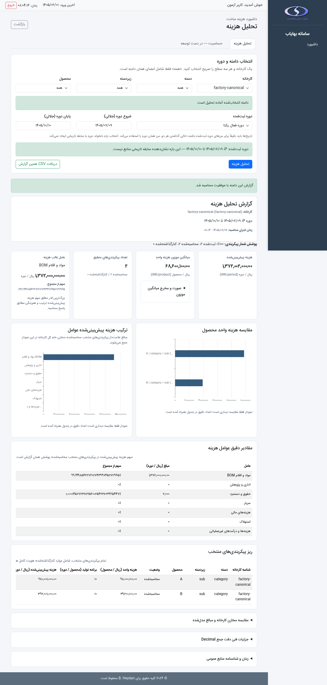
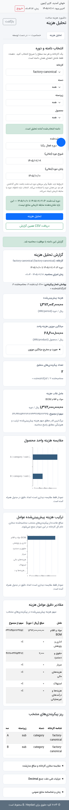

# PR-07 / DASH-4 — رابط تحلیل هزینه

صفحه `/dashboard` گزارش نسخه ۱ [PR-06](pr06-dashboard-cost-analysis-api.md)
را به فارسی و RTL ارائه می‌کند. پوسته مشترک، Bootstrap، IRANSansX، مجوز
`dashboard:READ` و فرمول و دروازه‌های G1–G4 حفظ می‌شوند. حساسیت غیرفعال است.

## انتخاب و دوره

یک کارخانه مجاز و انتخاب صریح دسته، زیردسته و محصول لازم است. مقدار خالی
انتخاب نیست؛ `__ALL__` فقط گزینه «همه» است. محصول با reference مرکب API
گزینه‌ها ارسال می‌شود. هر درخواست سلسله‌مراتب sequence و AbortController
مستقل دارد؛ کنترل‌های فرزند در زمان دریافت غیرفعال‌اند.

نقص محدود ادغام: پیاده‌سازی قبلی صفحه فقط کارخانه‌ها را bootstrap می‌کرد و
API گزینه‌ها هیچ metadata دوره‌ای نمی‌داد. مدیر نمی‌توانست دوره‌های نصب‌شده
و مرز آنها را بدون آگاهی از فایل binding انتخاب کند. اکنون فقط در bootstrap
صفحه، پس از بررسی دسترسی کارخانه، این فیلد عمومی افزوده شده است:

```text
filter_options.periods_by_factory[factory_id] = {
  options: [{id, start, end}],
  default_period_id: string | null,
  default_state: CostState,
  issues: [{code, state, message}]
}
```

`DashboardPeriodMetadata` از همان `CostInputLoader(read_only=True)` و
resolver binding استفاده می‌کند و فقط شناسه و مرزهای پذیرفته‌شده را برمی‌گرداند.
هیچ مسیر فایل، manifest یا مقدار پارامتر به صفحه افزوده نمی‌شود. چند binding
فعال، گزینه‌های صریح دارند و پیش‌فرض ضمنی ندارند. نبود/نامعتبر بودن دوره
پیام فارسی می‌دهد؛ صفحه دوره ایجاد نمی‌کند. metadata یک snapshot زمان دریافت
صفحه است؛ اعتبار دوره هنگام تحلیل دوباره توسط API بررسی می‌شود.

ورودی‌های قابل ویرایش جلالی با `JalaliDate.parseJalaliInput` به ISO Gregorian
تبدیل می‌شوند و باید دقیقاً با دوره منتخب برابر باشند. خالی بودن هر دو، ارسال
مرزها را حذف می‌کند؛ گزینه «دوره فعال یکتا» کلید `period` را حذف می‌کند. تاریخ
تک‌روز با helper مشترک `formatDateOnly` و اجزای تقویمی نمایش داده می‌شود تا
timezone مرورگر مرز را جابه‌جا نکند. تاریخ محاسبه، تاریخ واقعی منبع و baseline
مالک جدا هستند؛ دوره و fingerprint اثبات سابقه تاریخی نیستند.

## درخواست و گزارش

تحلیل lifecycle مستقل با cancellation، sequence و مقایسه دامنه دارد. هر
تغییر انتخاب/دوره/متن تاریخ گزارش قبلی و snapshot صادرات را فوراً باطل می‌کند.
اجرای هم‌زمان تکراری غیرفعال است؛ پاسخ دیررس دامنه قبلی پذیرفته نمی‌شود.
درخواست GET فقط کلیدهای قرارداد PR-06 را می‌فرستد. HTTP و JSON جدا حفظ می‌شوند؛
خطاهای دسترسی، redirect ورود، پاسخ غیر JSON، JSON نامعتبر، schema نامعتبر و
قطع ارتباط پیام فارسی دارند. پاسخ معتبر 422، پوشش، issues و ردیف‌های حذف‌شده
را نشان می‌دهد و اگر دامنه منطبق و ردیف توضیحی داشته باشد، همان snapshot قابل
صادرات است. خطاهای دسترسی/انتقال snapshot قابل صادرات ایجاد نمی‌کنند.

تمام مبالغ، برنامه تولید و درصدهای Decimal رشته می‌مانند. formatting نمایشی
رشته‌ای است؛ هیچ KPI مالی در JavaScript محاسبه یا گرد نمی‌شود. صفر معتبر، null
و `NOT_APPLICABLE` متمایزند. `PARTIAL` فقط «مجموع جزئی» و حذف‌ها را نشان می‌دهد.
رتبه، مقدار، سهم و هم‌رتبه‌های عامل غالب مستقیماً از backend می‌آیند؛ BOM و
شش شناسه دقیق مخزن، از جمله `Depriciation`، حفظ می‌شوند.

دو نمودار میله‌ای هزینه واحد محصول و contribution علامت‌دار عوامل، فقط از
`breakdowns.products/drivers` رسم می‌شوند. تبدیل عددی محدود به مختصات نمودار
است. Tooltip از rich text امن ECharts و قلم مشترک استفاده می‌کند. جدول همراه
همواره مقادیر دقیق، هویت کامل و ردیف‌های حذف‌شده را دارد. نبود/خطای کتابخانه
نمودار، تحلیل و جدول و صادرات را از کار نمی‌اندازد. مقایسه مخازن خام کل کارخانه،
مدل منتخب، مدل کامل دسته‌ها و اختلاف‌های مربوط، و جزئیات فنی جمع Decimal در
بخش‌های بازشدنی جدا ارائه می‌شوند.

## CSV

دانلود فقط snapshot پذیرفته‌شده همین دامنه را مصرف می‌کند؛ محاسبه دوم ندارد.
CSV با UTF-8 BOM، CRLF و quoting استاندارد ساخته می‌شود. متن‌های نامطمئن که
می‌توانند formula صفحه گسترده باشند با apostrophe محافظت می‌شوند؛ ستون‌های
عددی Decimal، از جمله مقادیر منفی و اختلاف‌ها، عین رشته اصلی می‌مانند.
ستون‌های canonical تاریخ در کنار ستون‌های نمایشی جلالی قرار دارند. هویت کامل،
وضعیت ردیف، کد/پیام امن، واحدها، دامنه، دوره و پوشش با داده‌های KPI و breakdown
در گزارش صادر می‌شوند. یک header ثابت و ستون `row_type`، ردیف‌های
`configuration`، `kpis`، `driver`، `factory_pool`، `pool_category` و
`arithmetic_reconciliation` را مشخص می‌کند؛ گزارش بدون پیکربندی ردیف `report`
دارد. فایل شامل مسیر منبع، raw source، یا مقادیر پنهان
پارامترها نیست.

## اجرا و آزمون

آزمون‌های API و metadata از fixtureهای ایزوله نسخه دوم استفاده می‌کنند و
نبود write را بررسی می‌کنند. آزمون‌های `tests/test_dashboard_frontend.py`
صفحه و assetهای واقعی را با Chromium و Flask مجاز اجرا می‌کنند، از جمله
رقابت درخواست‌ها، null/zero/precision، دوره جلالی، خطاها، CSV و نام‌های شبه HTML.
آزمون مرورگر در صورت نبود Playwright یا Chromium با دلیل صریح skip می‌شود.

```bash
python -m pip install Flask pandas openpyxl pytest playwright
python -m pytest tests/test_dashboard_frontend.py tests/test_dashboard_cost_analysis.py tests/test_dashboard_period_metadata.py
python -m compileall app.py modules utils
```

Chromium نصب‌شده با `DASHBOARD_CHROMIUM_PATH` قابل انتخاب است؛ در غیر این صورت
`chromium` یا `chromium-browser` جست‌وجو می‌شود. با
`DASHBOARD_UI_EVIDENCE_DIR` می‌توان screenshot دسکتاپ و موبایل مسیر fixture مجاز
را ذخیره کرد. چک‌های مرورگر CDN را قطع می‌کنند تا fallback مستقل از شبکه آزموده
شود. مقادیر fixture آزمایشی‌اند و داده واقعی عملیاتی در شواهد استفاده نمی‌شود.

نتیجه اعتبارسنجی این برش: ۲۸ آزمون Chromium و ۲۱۴ regression مرتبط موفق‌اند.
کتابخانه واقعی ECharts و fallback بدون کتابخانه هر دو اجرا شدند. کل مجموعه
backend برابر ۴۱۴ موفق و ۳۱ ناموفق بود؛ هر ۳۱ مورد ناموفق در `main` بدون
تغییر نیز تکرار شد (۳۷۷ موفق، ۳۱ ناموفق). بررسی syntax جاوااسکریپت، compile
پایتون و whitespace diff موفق بود. هیچ فایل عملیاتی `Data/` تغییر نکرد.

شواهد با fixture مجاز و کتابخانه واقعی نمودار:




