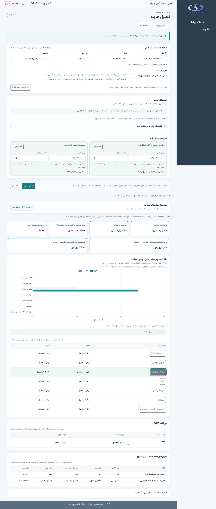
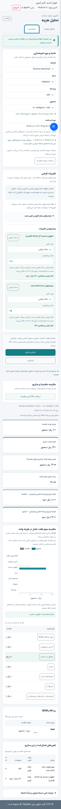
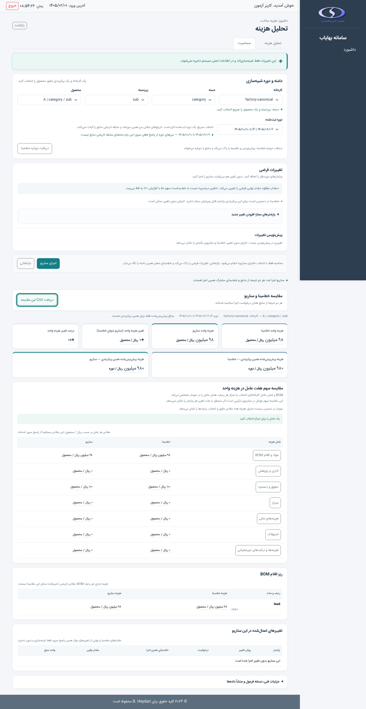
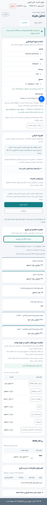
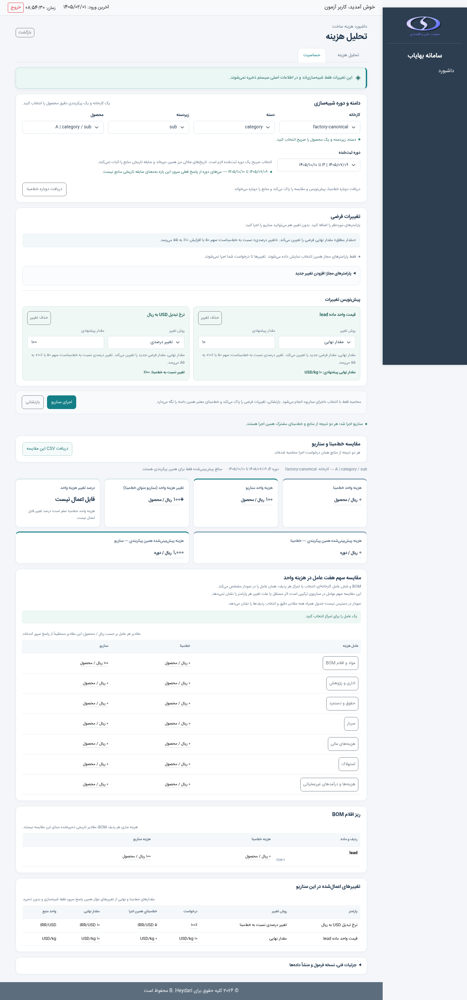
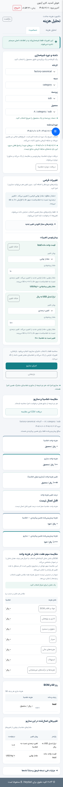

# PR-09 / DASH-6 — رابط فارسی حساسیت

این سند شواهد و قرارداد سازگار PR-09 را ثبت می‌کند. workspace فعلی
سناریوهای مستقل A/B و آزمایش‌ها را طبق
[PR-09A](pr09a-dashboard-visual-analytics.md) و
[راهنمای کاربر](dashboard-visual-analytics-user-guide.md) ارائه می‌دهد.
validator و lifecycle در [PR-10](pr10-dashboard-release-readiness.md) سخت‌تر
شده‌اند؛ endpoint تک‌سناریوی قدیمی همچنان برای compatibility پشتیبانی می‌شود.

این تغییر از `main` پس از ادغام PR-08 / GitHub #43 شروع شده است؛ commit پایه
`0d2fe9e29ef5536895fe38eb0c96d0b81a40b0da` است. تب حساسیت صفحه `/dashboard`
قرارداد [PR-08](pr08-dashboard-sensitivity-api.md) را به فارسی و RTL ارائه
می‌کند. فرمول، مجوز، binding دوره و منابع هیچ تغییری ندارند. تحلیل هزینه و
رفتار `ALL` آن مستقل باقی می‌مانند.

## مسیر کاربر

۱. کاربر در تب حساسیت یک کارخانه مجاز، دسته، زیردسته، reference مرکب محصول
و **شناسه صریح دوره نصب‌شده** را انتخاب می‌کند. گزینه «همه» یا انتخاب ضمنی اولین
محصول وجود ندارد. metadata دوره از bootstrap مجاز موجود می‌آید؛ مرزها با
`JalaliDate.formatDateOnly` جلالی نمایش داده می‌شوند. درخواست کلید `period`
را همیشه می‌فرستد؛ بازه ساختگی یا دوره فعال ضمنی استفاده نمی‌شود.

۲. `GET /api/dashboard/sensitivity/parameters` خط‌مبنای فعلی و registry مجاز
همین انتخاب را می‌گیرد. کارت‌ها هزینه واحد و هزینه پیش‌بینی‌شده **همین
پیکربندی**، BOM و سهم عوامل کارخانه را نشان می‌دهند. این هزینه مجموع کارخانه
یا میانگین تجمیعی نیست.

۳. فهرست عمومی و کارخانه‌ای جدا هستند. هر entry برچسب فارسی، مقدار دقیق،
واحد منبع، روش‌های مجاز و حدود مقدار نهایی را دارد. دکمه «افزودن تغییر» آن را
به پیش‌نویس اضافه می‌کند. چند پارامتر متمایز قابل ویرایش‌اند؛ همان ID دوباره
اضافه نمی‌شود. catalog پس از اجرای موفق جمع می‌شود و برای افزودن تغییر جدید
با صفحه‌کلید یا لمس بازشدنی است؛ پیش‌نویس همچنان دیده می‌شود.

۴. «مقدار نهایی» مقدار فرضی جدید را تعیین می‌کند. «تغییر درصدی» به خط‌مبنا
وابسته است؛ سهم ۵۰ با ‎+۱۰٪ برابر ۵۵ می‌شود، نه ۶۰. ورودی text و inputmode
decimal است. رقم فارسی، عربی و لاتین و جداکننده `٫` به رشته ASCII تبدیل
می‌شوند؛ علامت ابتدایی `+` و `−` به grammar canonical تبدیل می‌شوند. مقدار
خالی صفر نمی‌شود. متن اضافی، جداکننده هزارگان، comma، exponent، علامت‌های
داخلی و نمایش مبهم رد می‌شوند. مبالغ به `Number`، `parseFloat` یا JSON number
تبدیل نمی‌شوند. حدود absolute با مقایسه دقیق رشته کنترل می‌شوند؛ حدود نهایی
برای percent_change و محدودیت‌های ترکیبی فقط توسط سرور بررسی می‌شوند.

۵. «اجرای سناریو» تنها کنش ارسال POST است. درخواست فقط کلیدهای selection و
`overrides` متعلق به قرارداد را دارد؛ baseline، mapping منبع یا token ساختگی
نمی‌فرستد. سقف ۶۴ override، ۱۲۸ نویسه canonical هر مقدار و body ۶۴ KiB رعایت
می‌شود. aliasها ممکن است منبع مشترک داشته باشند؛ خطای تضاد سرور امن نمایش
داده می‌شود و پارامترها مستقل فرض نمی‌شوند.

۶. کارت‌های مقایسه هزینه واحد قبل/بعد، اختلاف علامت‌دار **ریال/محصول** و درصد
اختلاف را نشان می‌دهند. هزینه پیش‌بینی‌شده هر سمت جداست؛ projected delta
ساخته نمی‌شود. درصد برای baseline صفر، `NOT_APPLICABLE` است. جدول تغییرهای
مؤثر از `effective_overrides`، baseline_value و final_value همان POST می‌آید.

هشدار «این تغییرات فقط شبیه‌سازی‌اند و در اطلاعات اصلی سیستم ذخیره نمی‌شوند.»
همواره در تب قابل مشاهده است. ذخیره/اعمال به منبع، تاریخچه، اشتراک، بهینه‌سازی
یا انتخاب چندمحصولی/چندکارخانه‌ای در این PR وجود ندارد.

## مجوز و خطا

کنترل‌ها فقط از `parameters` پاسخ ساخته می‌شوند؛ ID، mapping یا applicability
از نام‌ها، prefixها یا فایل‌ها استنتاج نمی‌شوند. Dashboard-only و grant
کارخانه‌ای برای کارخانه دیگر، خط‌مبنای مجاز بدون کنترل قابل ویرایش دارند و
اجرای بدون تغییر ممکن است. general-only و factory-only فقط گروه خود را
می‌بینند. prediction و raw driver inputها فقط اگر مجاز و در پاسخ موجود باشند
نمایش داده می‌شوند؛ مقادیر حذف‌شده از هزینه‌ها بازسازی نمی‌شوند.

unsupported_parameters فقط اطلاعات امن خود پاسخ را نمایش می‌دهد؛ mapping
مبهم prediction کنترل نمی‌شود. پارامتر `MATHEMATICAL_ZERO` فعال می‌ماند:
اثر صفر آن با ثابت‌بودن دیگر ورودی‌های baseline معنا دارد و ترکیب تغییرها
می‌تواند اثر را فعال کند.

HTTP status از JSON جدا نگه داشته می‌شود. خطاهای 400، 403، 404، 413، 422،
503 و 500، redirect ورود/انقضای نشست، non-JSON، JSON/schema نامعتبر و قطع
شبکه پیام فارسی دارند. failure معتبر دارای baseline و registry مجازِ تازه،
همان context را نگه می‌دارد؛ scenario/delta موفق قبلی پاک می‌شوند. envelope
پیش از capture، access denied و انتقال نامطمئن، state محافظت‌شده را پاک
می‌کنند. حذف/تغییر مجوز، پیش‌نویس نامجاز و مقادیر popover قبلی را از DOM پاک
می‌کند؛ خطا مقدار ارسالی محافظت‌شده را بازتاب نمی‌دهد.

`DashboardSensitivityModel` validator/adapter مستقل دارد؛ payload به renderer
تحلیل هزینه داده نمی‌شود. وضعیت تک‌پیکربندی با aggregate `PARTIAL` و coverage
ساختگی مخلوط نمی‌شود؛ تحلیل هزینه همچنان PARTIAL خود را حفظ می‌کند.

## تازگی، رقابت درخواست و بازنشانی

hierarchy، registry GET و scenario POST cancellation و generation مستقل
دارند. نتیجه پذیرفته‌شده به انتخاب دقیق، دوره و revision پیش‌نویس متصل است.
ویرایش/حذف، تغییر selection و Reset فوراً مقایسه و CSV را باطل می‌کنند؛ حتی
پاسخی که cancellation را نادیده بگیرد با generation/scope کنار گذاشته می‌شود.
اجرای تکراری در زمان درخواست غیرفعال است.

هر POST خط‌مبنا، مجوز و source context را تازه می‌سازد. **هر دو نتیجه فقط از
همان POST پذیرفته‌شده‌اند**؛ GET قدیمی یا Cost Analysis aggregate طرف دیگر
مقایسه نمی‌شود. registry پس از POST تازه می‌شود؛ اگر مقدارهای مجاز یا lineage
تغییر کرده باشند پیام روشن استفاده از baseline تازه داده می‌شود.

«بازنشانی» scenario pending را لغو/باطل می‌کند، draft/comparison/CSV را پاک
می‌کند و آخرین baseline مجاز همان scope را، از جمله baseline تازه POST، نگه
می‌دارد. درخواست تازه یا source-save ندارد. «دریافت دوباره خط‌مبنا» کنش جدا
با برچسب صریح است؛ draft/comparison را پاک می‌کند و GET جدید می‌فرستد. baseline
انتخاب دیگر هرگز برگردانده نمی‌شود.

## نمودار، مقادیر دقیق و CSV

نمودار grouped-bar افقی BOM و شش driver با `per_unit_contribution` را قبل و
بعد مقایسه می‌کند. رنگ baseline و scenario جدا، برچسب‌ها پایدار، محور فشرده
و tooltip از رشته‌های اصلی است. این contributionهای **سناریوی ترکیبی** است؛
اثر مستقل هر override، tornado یا attribution علی نیست. مقادیر برای reconcile
اجباری جمع/تغییر داده نمی‌شوند. تنها مختصات متناهی نمودار تبدیل عددی دارند.
جدول همراه همیشه exact buttons و کنترل focus هر عامل با صفحه‌کلید/لمس دارد.
resize، teardown و تغییر تب مدیریت می‌شوند؛ نبود یا شکست ECharts، جریان
سناریو، کارت‌ها، جدول و CSV را از کار نمی‌اندازد.

`DashboardNumbers` rounding نمایشی و exact-value/copy را از رشته backend جدا
می‌کند. صفر، null، tiny nonzero و NOT_APPLICABLE متمایزند؛ source unitهایی مثل
USD/kg نیز در مقدار دقیق حفظ می‌شوند. popover مشترک پس از close هیچ مقدار
قبلی را در hidden DOM نگه نمی‌دارد. پاک‌کردن یک report، ثبت کنترل‌های exact
تب دیگر را از بین نمی‌برد. version/formula/fingerprint و source context در
details بسته پیش‌فرض‌اند؛ شناسه‌ها با ASCII اصلی قابل مشاهده و کپی هستند.
fingerprint یا baseline مالک مدرک تازگی تاریخی معرفی نمی‌شود.

CSV تنها snapshot موفق پذیرفته‌شده را با Decimalهای اصلی صادر می‌کند. هویت،
دوره canonical، واحدها، نتایج هر سمت، delta بازگشتی و effective overrides
حفظ می‌شوند؛ non_persistent و برچسب فارسی شبیه‌سازی صریح‌اند. UTF-8 BOM، CRLF،
quoting و محافظت formula injection متن نامطمئن وجود دارد. مقادیر عددی منفی
Decimal متن دقیق خود را نگه می‌دارند. source path، ورودی redacted، DOM
formatted و costing request تازه استفاده نمی‌شوند. برای حفظ دقت در spreadsheet
ستون‌های Decimal هنگام import باید متن انتخاب شوند.

## اجرای اعتبارسنجی

آزمون browser از Flask واقعی مجاز، Chromium، fixtureهای نصب‌شده V2 مشترک
PR-07/08 و API واقعی حساسیت استفاده می‌کند. startup برنامه و داده عملیاتی
وارد harness نمی‌شوند. inventory فایل/دایرکتوری، SHA-256 و mtime منابع fixture
پیش/پس از تعامل API بررسی می‌شود؛ تغییرهای عمدی fixture برای freshness/revocation
قبل از checkpoint تازه انجام می‌شوند.

```bash
python -m pip install Flask pandas openpyxl pytest playwright
python -m pytest tests/test_dashboard_sensitivity_frontend.py tests/test_dashboard_sensitivity_model.py tests/test_dashboard_frontend.py tests/test_dashboard_numbers.py
python -m pytest tests/test_dashboard_sensitivity.py tests/test_dashboard_cost_analysis.py tests/test_dashboard_period_metadata.py tests/test_dashboard_readonly_loader.py tests/test_costing_engine.py
python -m compileall app.py modules utils
for asset in static/js/dashboard-*.js; do node --check "$asset"; done
git diff --check
```

Playwright و Chromium لازم‌اند؛ نبود آنها با دلیل صریح skip می‌شود.
`DASHBOARD_CHROMIUM_PATH` مرورگر را انتخاب می‌کند. ECharts واقعی cacheشده با
`DASHBOARD_ECHARTS_PATH` و Bootstrap CSS با `DASHBOARD_BOOTSTRAP_PATH` به
درخواست CDN ارائه می‌شوند؛ fallback با remote scripts قطع‌شده آزموده می‌شود.
`DASHBOARD_UI_EVIDENCE_DIR` شش screenshot fixture ایزوله را ذخیره می‌کند.

نتیجه اعتبارسنجی با Flask 3.1.3، pandas 3.0.6، openpyxl 3.1.5، pytest 9.1.1،
Node 24 و Chromium واقعی:

- **۳۹ آزمون Sensitivity در Chromium، بدون skip، موفق‌اند.** سه golden با API
  واقعی از مرورگر بررسی شدند: BOM تکراری ۱۴۰ ← ۱۵۴؛ prediction با هزینه واحد
  ۱۰۰ ← ۵۰ و هزینه همین پیکربندی ۱۰۰۰ ← ۱۵۰۰؛ سهم مطلق ۵۰ ← ۲۵ با هزینه واحد
  ۱۰۰ ← ۲۰۰. baseline با Cost Analysis canonical per-configuration برابر بود.
- **۵۷ آزمون Chromium موجود تحلیل هزینه موفق‌اند.** formatting، CSV، PARTIAL،
  درخواست‌ها، ECharts و exact-value همچنان بررسی شدند. regression تازه تغییر
  بین دو تب و کپی مقدار/شناسه و واحد منبع را نیز پوشش می‌دهد.
- **۸ آزمون مدل با Node موفق‌اند**؛ grammar و حدود دقیق، envelopeهای nullable
  واقعی و redaction، snapshot immutable، CSV دقیق و واحد مستقل هر ستون بررسی
  شدند. ۳۰۲ regression متمرکز API حساسیت، تحلیل هزینه، costing، read-only،
  period و formatter نیز موفق‌اند.
- اجرای گسترده backend: **۵۷۶ موفق، ۳۱ ناموفق**. اجرای `main` بدون تغییر روی
  commit پایه: **۵۶۹ موفق، همان ۳۱ ناموفق**؛ شناسه‌های failure در JUnit دقیقاً
  برابرند. پس از افزودن چک واحد مستقل CSV، مدل نهایی دوباره با ۸ آزمون موفق
  بررسی شد. اجرای نهایی localization/font/filter/number/model برابر ۵۳ موفق و
  یک failure موجود `test_factory_parameters_display_labels_preserve_contract_fields`
  بود؛ آن failure در هر دو اجرای گسترده نیز موجود است. assertion نامرتبط
  ضعیف یا حذف نشده است.
- compile پایتون، syntax همه assetهای Dashboard و `git diff --check` موفق‌اند.
  همه ۸۷ فایل و ۲۲ دایرکتوری عملیاتی `Data/` inventory و SHA-256 قبلی را حفظ
  کردند. harness مرورگر نیز در هر مورد inventory/SHA-256/mtime fixture و نبود
  درخواست source-save را بررسی کرد.

برای اجرای گسترده باید پیش از import `app.py` یک Profile خالی **ایزوله** ساخت
تا startup سراغ store واقعی یا migration عملیاتی نرود:

```bash
mkdir -p work/pr09-validation
python - <<'PY'
from pathlib import Path
from utils.profile_store import ProfileDataStore
ProfileDataStore(Path.cwd() / "work/pr09-validation/profiles.json").initialize({})
PY
APP_DATA_FILE="$PWD/work/pr09-validation/profiles.json" APP_SECRET_KEY=pr09-isolated-test python -m pytest tests --ignore=tests/test_dashboard_frontend.py --ignore=tests/test_dashboard_sensitivity_frontend.py -q --junitxml=work/pr09-validation/tests.xml
```

شواهد زیر از صفحه واقعی و fixture مجازند، داده تولید نیستند. نسخه دسکتاپ و
موبایل هر سه حالت مشاهده شدند. پس از مشاهده، جای کارت‌های اصلی/هزینه دوره،
اندازه headingها، فاصله‌ها، واحد منبع و کوتاه‌کردن catalog پس از اجرا اصلاح
شدند و screenshotها دوباره گرفته شدند. جدول‌های بزرگ در ظرف خود پیمایش
می‌کنند؛ صفحه در عرض موبایل overflow افقی ندارد.







